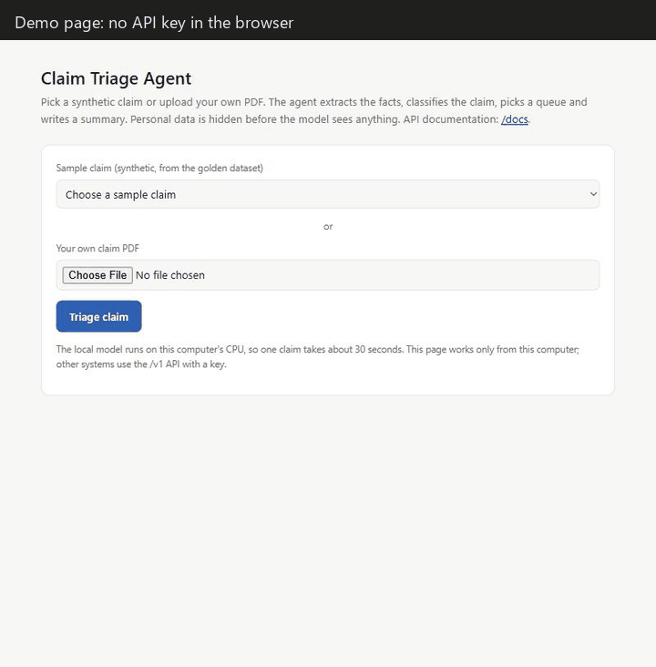
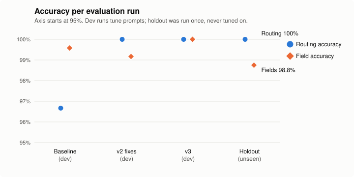
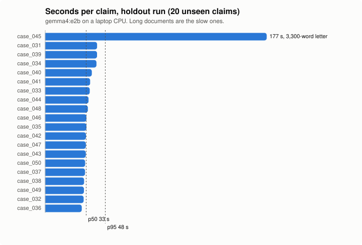
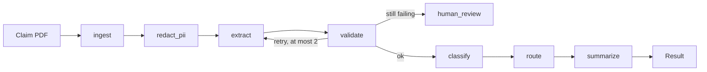

# Claim Triage Agent

[](https://github.com/ArmieManuel/claim-triage-agent/actions/workflows/ci.yml)


An AI agent that reads an insurance claim PDF and returns the claim's facts, its category, the team it should go to (with the reasons) and a short summary for the handler. It hides personal data before the model sees anything, checks every model answer in code, sends uncertain claims to a human, and is measured on a golden dataset with quality gates in CI.

Runs fully on a laptop with a local open model. **All data is synthetic**: claimants from Germany, Italy and Austria, amounts in euros, documents in English.



## The problem

Claims teams receive forms, letters and emails in every shape. Someone has to read each one, type the key facts into a system, decide what kind of claim it is and pass it to the right team. This agent does that first pass. It is not allowed to guess: missing facts, two claims in one document, an ambiguous claim type or repeated extraction failures all go to `human_review`.

| In | Out |
|---|---|
| A text-based claim PDF | Claim number, policy number, date of loss, claimant role, amount, location, policy start, police reference, loss description |
| | Category: `motor_collision`, `motor_theft`, `property_water`, `property_fire`, `liability`, `other`, with confidence |
| | Queue: `auto_process`, `standard_handler`, `senior_handler`, `fraud_review` or `human_review`, **with reasons** |
| | A 3 to 5 sentence summary, warnings, and a per-step trace with latency and tokens |

## Results

Measured with `python -m evals.run_eval` on the golden dataset: 50 synthetic claims, 10 of them hard cases (missing fields, ambiguous category, two claims in one email, unusual date formats, 2,400 and 3,300 word letters). Prompts were tuned on the 30 **dev** claims only; the 20 **holdout** claims were run once.

| Metric | Dev, final (30) | **Holdout (20, never tuned on)** |
|---|---|---|
| Routing accuracy | 100% | **100%** |
| Routing accuracy, hard cases | 6 of 6 | **4 of 4** |
| Classification accuracy, macro F1 | 100%, 1.00 | **100%, 1.00** |
| Field accuracy, mean of 8 fields | 100% | **98.8%** |
| Personal data removed before the model | 100% | **100%** |
| Human review rate (expected) | 13.3% (13.3%) | **10% (10%)** |
| Latency per claim, p50 / p95 | 27 s / 43 s | **33 s / 48 s** |
| Tokens per claim, in / out | 1,918 / 349 | 2,210 / 349 |

Model `gemma4:e2b` (2.3B effective parameters) on a laptop CPU (Intel i5-11320H, 16 GB RAM), prompts `extract-v3`, `classify-v2`, `summarize-v1`. Sources: [`reports/20261026-173823_dev_v3`](reports/20261026-173823_dev_v3/summary.md) and [`reports/20261026-181213_holdout_milestone-phase4`](reports/20261026-181213_holdout_milestone-phase4/summary.md). With 20 to 30 cases one claim moves a rate by 3 to 5 points, so these numbers show the pipeline works on this synthetic data, not how it would do on real claims.



How the dev numbers got there, one measured change at a time:

| Run | Change | Routing | Fields |
|---|---|---|---|
| [Baseline](reports/20261026-134704_dev_baseline/summary.md) | v1 prompts | 96.7% | 99.6% |
| [v2](reports/20261026-141111_dev_v2-fixes/summary.md) | a second fitting category caps confidence; dates must appear in the document, read day first | 100% | 99.2% |
| [v3](reports/20261026-173823_dev_v3/summary.md) | police numbers only when the document mentions the police | 100% | 100% |
| [Broken on purpose](reports/20261026-175205_dev_broken-prompt-demo/README.md) | prompt says the date of loss is the date the letter was sent | 100% | 99.2% |

The last row is the regression demo: the quality gates still passed, and `python -m evals.regression` caught the drop in date accuracy and failed.



The model calls are 99.9% of the time (extract about 25 s, summarize 11 s, classify 8 s). Long documents are the slow ones.

## How it works



| Step | Model? | What it does |
|---|---|---|
| ingest | no | Reads the PDF; rejects empty, non-PDF, scanned and oversized files |
| redact_pii | no | Replaces names, addresses, phones, emails, national IDs and plates with `[NAME_1]`-style placeholders |
| extract | **yes** | Fills a JSON schema enforced by Ollama's structured output |
| validate | no | Dates and amounts must parse; claim, policy and police numbers, town and dates must appear in the document; errors go back to the model |
| classify | **yes** | Category and confidence; naming a second fitting category caps confidence at 0.5 |
| route | no | Plain rules from [`config/routing.yaml`](config/routing.yaml), every decision with reasons |
| summarize | **yes** | 3 to 5 sentences, checked for numbers that are not in the claim |

Only three of the seven steps use the model; the others guard it. More in [docs/architecture.md](docs/architecture.md).

**Routing rules** (first match wins): human review if something is missing, ambiguous or failing; fraud review if the loss is within 30 days of the policy start or a car theft has no police report; senior handler above 25,000 euros or for liability; auto process up to 2,500 euros except theft and liability; standard handler otherwise.

## Run it

### With Docker (three commands)

```bash
git clone https://github.com/ArmieManuel/claim-triage-agent.git
cd claim-triage-agent
docker compose up --build
```

Open <http://127.0.0.1:8000/>, pick a sample claim and click **Triage claim**. The first start downloads the model (about 4.6 GB) into a Docker volume. API docs: <http://127.0.0.1:8000/docs>.

### Without Docker (Windows, macOS or Linux)

Needs Python 3.13 and [Ollama](https://ollama.com/download).

```bash
ollama pull gemma4:e2b
python -m venv .venv
.venv/bin/pip install --constraint requirements.lock -e ".[dev]"    # Windows: .venv\Scripts\pip
.venv/bin/python -m uvicorn triage.api.app:app --port 8000
```

### Use the API

Copy `.env.example` to `.env` and set your own key, then:

```bash
curl -H "X-API-Key: <your key>" -F "file=@data/golden/dev/case_002.pdf" http://127.0.0.1:8000/v1/triage
```

Other ways in: `python -m triage.cli some_claim.pdf` and `GET /v1/metrics` for request counts, error rate and latency.

### Reproduce the numbers

```bash
python -m pytest                                        # 417 tests, no model, no network
python -m evals.run_eval --split holdout --label mine   # the real model, about 12 minutes
python -m evals.regression --split holdout              # compare with the committed holdout run
```

Without a model, replay the answers recorded in [`evals/cassettes/ci_subset.json`](evals/cassettes/ci_subset.json), exactly as CI does:

```bash
TRIAGE_LLM_PROVIDER=replay python -m evals.run_eval --cases case_001 case_002 case_005 case_007 case_012 case_013 case_018 case_019 case_026 case_030
```

## Quality and safety

- **Golden dataset**: [`data/generator`](data/generator) builds the 50 claim PDFs and their correct answers from the same spec, so the answers are right by construction. Three layouts (form, letter, email), varied labels and formats, German, Italian and Austrian claimants. A test fails if a committed file drifts from the generator.
- **Evaluation harness** ([`evals/`](evals)): field accuracy per field, classification accuracy and macro F1, routing accuracy, human review and retry rates, latency p50 and p95, tokens, PII recall. Each run writes `cases.csv` (with predicted and expected values), `metrics.json` and `summary.md` to `reports/`, with the git commit and prompt versions.
- **Quality gates** ([`evals/thresholds.yaml`](evals/thresholds.yaml)) fail the run below set levels; **the regression check** flags any metric that got worse than the previous run.
- **CI** ([`.github/workflows/ci.yml`](.github/workflows/ci.yml)): lint (ruff, format, no em dashes), 417 tests with a fake model and no network, the evaluation on ten dev cases replayed from recorded answers with the gates, and a Docker build. Branch protection requires all four checks; [pull request #1](https://github.com/ArmieManuel/claim-triage-agent/pull/1) shows a deliberately failing test blocking the merge.
- **Privacy by design** ([docs/privacy_and_governance.md](docs/privacy_and_governance.md)): redaction before any model call, tests that no planted personal value reaches a prompt or a log line, nothing stored, a local model, and the GDPR obligations a real deployment would have. Design documentation, not legal advice.
- **Observability**: JSON log lines per step with request id, latency, tokens and outcome; placeholders only.
- **Security**: API key for `/v1` (constant time comparison), keyless demo page answers only the local machine, upload size and type checks, non-root container.

## Design decisions and limits

- **Decisions in code, language in the model.** Thresholds, routing, date and amount checks and the ambiguity cap are tested Python, not prompt text.
- **One provider interface.** Ollama, a fake for tests, a replay of recorded answers for CI and an Azure stub sit behind the same `generate()` call.
- **Retry only what a retry can fix.** Bad formats and values not found in the document go back with feedback; missing facts go straight to a human.
- **The demo page holds no key.** It posts to a server route that runs the agent itself (backend for frontend) and answers only this machine; other systems use `/v1` with a key.

Limits: synthetic documents from one generator; English text only; no OCR; rule-based redaction tuned on dev; the model's own confidence is unreliable, which the second-category rule only partly fixes; about 30 s per claim on a laptop CPU, three minutes for the longest letter.

## What I would do next

- A user login (company SSO) in front of the demo page, so it can run beyond one machine
- A named-entity model for redaction (for example Presidio) and recall measured on real, consented documents
- An API and worker split with a job queue once several claims arrive at the same time ([trade-off](docs/architecture.md#why-one-service-and-not-microservices-yet))
- German and Italian documents and OCR for scans, then a larger model or a GPU
- Deployment to Azure with Azure OpenAI under a no-training agreement (planned, not built)

## Project layout

```
src/triage/          the agent: graph.py, nodes/, pii.py, rules.py, prompts/, llm/, api/
data/generator/      synthetic claim generator      data/golden/   50 claims + answers
evals/               run_eval, metrics, regression, thresholds, recorded answers
reports/             every evaluation run, committed as evidence
docs/                architecture, privacy and governance, model card, routing policy
tests/               unit, integration and API tests
```

Built test first, phase by phase, following [PLAN.md](PLAN.md).
