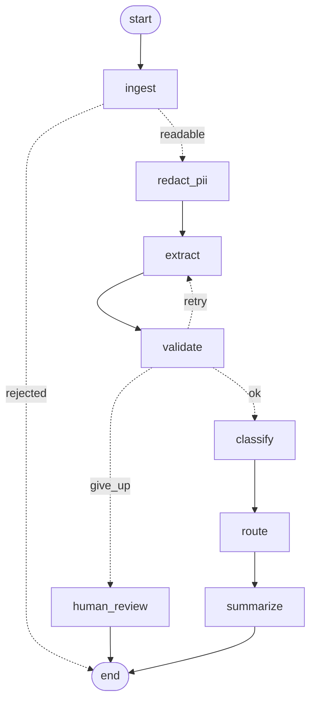
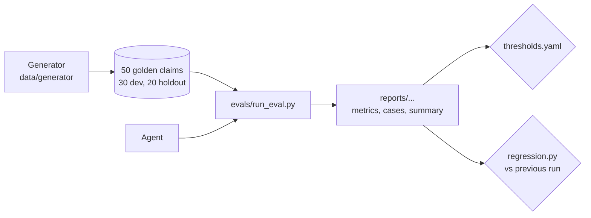

# Architecture

## System

```mermaid
flowchart LR
    subgraph clients[Clients]
        page[Demo page<br/>local only, no key]
        machine[Other systems<br/>X-API-Key]
    end
    subgraph api[FastAPI service]
        demo[/demo/triage/]
        v1[/v1/triage/]
        svc[TriageService<br/>size and type checks, metrics]
    end
    subgraph agent[LangGraph agent]
        graph[7 nodes, retry loop,<br/>human review fallback]
    end
    ollama[(Ollama<br/>gemma4:e2b, local)]
    logs[[JSON logs<br/>/v1/metrics]]

    page --> demo --> svc
    machine --> v1 --> svc
    svc --> graph --> ollama
    graph --> logs
```

Everything runs on one machine. `docker-compose.yml` starts the API and Ollama as two containers; locally they run as `uvicorn` and the Ollama desktop app.

## The agent graph

Generated by LangGraph from `src/triage/graph.py` (`build_graph(...).get_graph().draw_mermaid()`):



| Node | Model call | What it does | Code |
|---|---|---|---|
| ingest | no | Read the PDF text; reject empty, non-PDF, scanned and oversized files | `nodes/ingest.py` |
| redact_pii | no | Replace personal data with placeholders before any model call | `pii.py` |
| extract | yes | Fill the extraction JSON schema; retries get the validation errors as feedback | `nodes/extract.py` |
| validate | no | Parse dates and amounts; claim, policy, police number, town and dates must appear in the document | `nodes/validate.py` |
| classify | yes | Category, confidence and a second fitting category, which caps confidence at 0.5 | `nodes/classify.py` |
| route | no | Plain rules from `config/routing.yaml`, each decision with reasons | `rules.py` |
| summarize | yes | 3 to 5 sentences, checked for numbers that are not in the claim | `nodes/summarize.py` |

## Design decisions

- **Decisions in code, language in the model.** The model reads and writes text; routing, thresholds, date and amount checks, and the ambiguity cap are plain Python, unit tested and explained by reasons.
- **One provider interface.** `llm/base.py` defines `generate(system, prompt, schema)`. Ollama, a fake for tests, a replay of recorded answers for CI, and an Azure stub all fit behind it; switching is a setting.
- **Schema-constrained output.** Ollama's `format` parameter forces the JSON shape; Pydantic validates it again.
- **Retry only what a retry can fix.** Wrong formats and values not found in the document go back to the model with feedback, at most twice. Missing values go straight to human review.
- **Versioned prompts.** Prompt files carry a version, and every evaluation report records the versions it used.
- **Measure, then change.** Every prompt or rule change is compared with the previous run by `evals/regression.py`.

## Why one service and not microservices (yet)

PLAN.md lists a stretch goal: split the API and an extraction worker into two services talking over HTTP. It was **not built**, on purpose:

| | One service (now) | API plus worker |
|---|---|---|
| Moving parts | One container plus Ollama | Two containers plus Ollama, a queue or HTTP contract between them |
| Latency | No extra hop | An extra network hop per request (small next to 30 s of model time) |
| Scaling | API and model work scale together | Workers scale with load while the API stays small; long requests do not block the web server |
| Failure handling | A slow model call holds an API worker | The API can accept, queue and return a job id; retries and timeouts live in the worker |
| When it pays off | One laptop, one user | Many concurrent uploads, several model instances, or a GPU pool |

With one CPU running one model, a second service adds a contract to maintain without any speed or reliability gain. The code is already split where the boundary would go: `api/service.py` is the only place the API calls the agent, so a worker would replace `run_triage(...)` in that file with an HTTP or queue call.

## Quality loop



In CI, `eval` runs on ten dev cases with **recorded model answers** (`evals/cassettes/ci_subset.json`), so the whole graph and the gates run on every push without a model. A prompt change changes the recorded keys, and the replay fails until the answers are recorded again with the real model.
